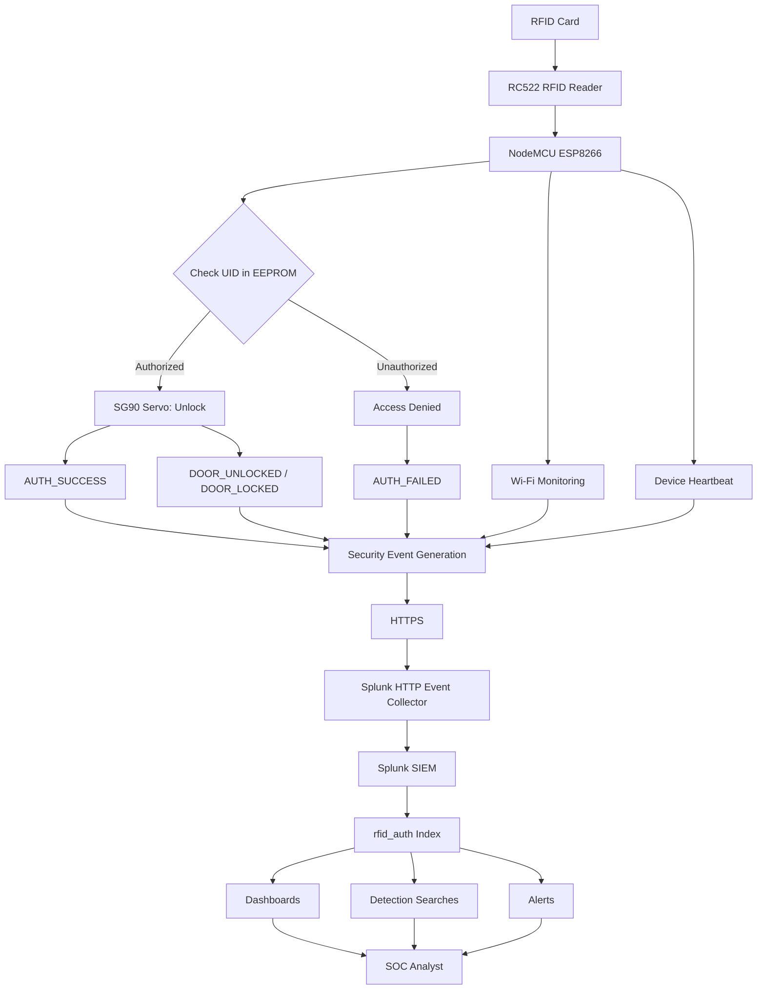

# System Architecture – IoT Security Monitoring with Splunk

## 1. Overview

This project integrates an IoT-based RFID access-control system with Splunk SIEM to provide centralized security logging, device-health monitoring, and security-event analysis.

The NodeMCU ESP8266 acts as the central controller. It communicates with the RC522 RFID reader, controls the SG90 servo motor, and forwards generated security events to Splunk using the HTTP Event Collector (HEC) over HTTPS.

## 2. Hardware Architecture

| Component | Responsibility |
|---|---|
| NodeMCU ESP8266 | Main controller and event generator |
| RC522 RFID Reader | Reads RFID card identifiers |
| RFID Card | Provides an identifier for authentication |
| EEPROM | Stores registered card identifiers and usernames |
| SG90 Servo Motor | Simulates the door-lock mechanism |

## 3. Authentication and Door-Control Flow

1. A user presents an RFID card to the RC522 reader.
2. The RC522 reads the card's UID.
3. The ESP8266 checks the UID against registered records stored in EEPROM.
4. If the UID matches a registered user, authentication succeeds.
5. The servo rotates to simulate unlocking the door.
6. After the configured unlock period, the servo returns to the locked position.
7. If the UID does not match, access is denied.

## 4. Security Event Generation

The ESP8266 generates events to record device and access-control activity.

| Event Type | Description |
|---|---|
| DEVICE_BOOT | Device startup |
| WIFI_CONNECTED | Initial Wi-Fi connection |
| WIFI_DISCONNECTED | Wi-Fi disconnection reported by the firmware |
| WIFI_RECONNECTED | Wi-Fi connection restored |
| DEVICE_HEARTBEAT | Periodic device health event |
| AUTH_SUCCESS | RFID authentication succeeded |
| AUTH_FAILED | RFID authentication failed |
| DOOR_UNLOCKED | Door unlock action |
| DOOR_LOCKED | Door lock action |

These events provide information that can be used for security monitoring and troubleshooting.

## 5. Data Transmission Architecture

The data transmission process works as follows:

1. The ESP8266 creates a security event.
2. The event is formatted as JSON.
3. The device establishes an HTTPS connection to the Splunk HEC endpoint.
4. The HEC token is included in the HTTP Authorization header.
5. Splunk HEC receives the event.
6. Splunk processes and indexes the event in the `rfid_auth` index.

**Communication details:**

| Parameter | Configuration |
|---|---|
| Protocol | HTTPS |
| Destination | Splunk Enterprise |
| Ingestion service | HTTP Event Collector |
| HEC port | 8088 |
| Splunk index | rfid_auth |
| Data format | JSON |

## 6. Splunk SIEM Monitoring

After ingestion, Splunk can be used to search, visualize, and monitor the events.

The project includes these monitoring use cases:

- RFID authentication monitoring
- Repeated failed access attempts
- Device heartbeat monitoring
- Wi-Fi disconnection monitoring
- Device availability monitoring

These searches help a SOC analyst investigate authentication activity and identify device-health or connectivity issues.

## 7. End-to-End Architecture Diagram

## 8. Security Considerations

- Use HTTPS to protect event transmission.
- Keep Wi-Fi credentials and HEC tokens out of public source code.
- Restrict access to the Splunk HEC endpoint.
- Rotate credentials and tokens that have been exposed.
- Monitor failed authentication attempts and device availability.

## 9. Current Limitations

- The project uses RFID UID matching and does not implement cryptographic authentication of RFID cards.
- Wi-Fi disconnection events do not independently prove a deauthentication attack.
- Event delivery depends on the device having network connectivity.
- The servo-based mechanism is a demonstration and should not be treated as a production physical door lock.

## 10. Conclusion

This architecture demonstrates how an IoT access-control device can generate security telemetry and forward it to a centralized SIEM platform.

By integrating RFID authentication, device-health events, HTTPS-based event ingestion, and Splunk monitoring, the project provides a practical demonstration of IoT security logging and SOC monitoring.
